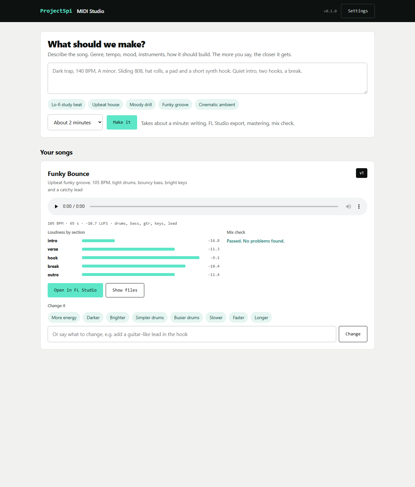

# Project5pi MIDI for Claude

**Give Claude a song idea. Get back a real FL Studio project, a mastered MP3 and a MIDI file.**

Claude (or any AI, or you) writes a short JSON description of a song: key, tempo,
chords, drum grids, melody, arrangement. `p5midi` writes it straight into an
FL Studio `.flp`, using your own FL Studio template for the sound, renders it with
FL Studio's command line, masters it, and measures the result, so an AI that
cannot hear still gets told "the intro is louder than the drop" or "the mix is
13 dB bass-heavy" and can fix it.

**Not a terminal person?** A one-click desktop app (type an idea, click Make; free for 5 songs a month) is in the works: [join the waitlist](https://project5pi.com/midi/?ref=github).

No clicking, no MIDI loopback driver, no controller script. The `.flp` opens in FL
Studio with every note, pattern and playlist clip editable.

**Listen:** three songs written from the example specs, rendered by FL Studio 2026
with only its stock template instruments:
[trap](docs/demo/night-drive-trap.mp3) ·
[lo-fi](docs/demo/rainy-window-lofi.mp3) ·
[house](docs/demo/warehouse-house.mp3)

```
idea --> Claude --> song.json --> p5midi build --> song.flp (+ song.mid)
                                         |
                    FL64.exe /R  <-------+  (your FL Studio renders it)
                         |
                     song.wav --> master --> song.mp3 --> analyze --> notes back to Claude
```

## Why this exists

FL Studio has a Python API, but it only runs inside the app and only for MIDI
controller and piano-roll scripts: it can't create channels, place playlist clips
or render. Existing AI bridges drive the open app over a virtual MIDI port, so
someone has to have FL open and export by hand. This project goes around the app
instead: it reads and writes the project file directly (we worked out the format
changes up to FL 2026; see [docs/FLP-FORMAT.md](docs/FLP-FORMAT.md)) and uses FL's
own headless render. One command goes from text to MP3 in about 20 seconds.

## Quick start

Needs Python 3.10+. Rendering needs Windows, FL Studio (20.7 or newer; tested
up to FL Studio 2026) and [ffmpeg](https://ffmpeg.org) on PATH.

```bash
pip install "project5pi-midi-for-claude[mcp] @ git+https://github.com/ProjectFlowmar/project5pi-midi-for-claude"

p5midi templates                          # FL Studio templates on this machine
p5midi inspect HipHop-Trap                # their channels (instruments)
p5midi make examples/night-drive-trap.json -o out/night-drive.flp
```

`make` writes `night-drive.flp`, `.mid`, `.wav` and a mastered `.mp3`, then prints
a report like this (trimmed):

```json
"master":   {"lufs": -10.3, "true_peak_db": -1.4},
"sections": [["intro", -14.8], ["hook 1", -8.8], ["break", -12.2], ["hook 2", -8.8], ["outro", -15.5]],
"notes":    []
```

FL Studio must be closed while rendering; an open FL grabs the command instead.

## Studio app: type an idea, click Make

```bash
pip install "project5pi-midi-for-claude @ git+https://github.com/ProjectFlowmar/project5pi-midi-for-claude"
p5midi studio          # opens http://127.0.0.1:47390 in your browser
```



Describe the song and click **Make it**. About 40 seconds later you have the FL Studio
project, MP3 and MIDI. If the mix check finds a problem, the AI fixes it and renders
again before you hear it. Then use **More energy / Darker / Simpler drums...** or type
any change; every version is kept. **Open in FL Studio** opens the project, and
**Export stems** writes one aligned WAV per instrument for mixing anywhere.

The Studio writes songs with any OpenAI-compatible model. Paste a DeepSeek key in
Settings (about half a cent per song with `deepseek-v4-flash`), or point it at OpenAI,
OpenRouter or a local model. Same from the command line:

```bash
export DEEPSEEK_API_KEY=sk-...
p5midi create "Lo-fi study beat, 80 BPM, dusty piano, swung drums" --seconds 90
p5midi change "songs/20261107-...-dusty-piano" "darker, slower"
```

Pick a **genre pack** (Boom Bap, Atlanta Trap, West Coast G-Funk, Drill, Neptunes Bounce,
Timbaland Rhythm, Lo-fi Chill, Afrobeats, Reggaeton, R&B Slow Jam) to give the AI that genre's
recipe: template, tempo range, drum patterns, harmony and arrangement rules, plus the producer
techniques from the influence database. Ask for **2 or 3 versions** to get different takes on
the same idea, each in its own folder:

```bash
p5midi packs
p5midi create "Smooth cruise for a barbershop promo" --pack g-funk --versions 2 --seconds 60
```

The [Windows app](https://project5pi.com/midi/?ref=github) needs no key: free for 5 songs a
month (Boom Bap and Atlanta Trap packs included); Unlimited adds every pack and several versions
per idea. With your own key, everything here is free and open source.

## Use it from Claude

**Claude Code / Claude Desktop (MCP).** Register the server:

```bash
claude mcp add p5midi -- p5midi-mcp
```

or in Claude Desktop's `claude_desktop_config.json`:

```json
{ "mcpServers": { "p5midi": { "command": "p5midi-mcp" } } }
```

Tools: `list_templates`, `inspect_template`, `spec_format`, `build_song`,
`make_song`, `render`, `analyze_audio`, `master_audio`. Then ask:
*"Make me a dark 140 BPM trap beat in A minor with a sliding 808, about a minute long."*

**Claude Code skill.** Copy `skills/fl-studio-composer` into `~/.claude/skills/`
to teach Claude the compose → make → read the report → fix loop with the CLI.

## The song spec

```json
{
  "template": "HipHop-Trap", "bpm": 140, "key": "A minor",
  "progression": ["i", "VI", "III", "VII"],
  "parts": {
    "drums": {"type": "drums", "channel": "Drums",
              "lanes": {"kick": "x......x..x.....", "clap": "........x.......", "hat": "x.x.x.x.x.x.x.x."}},
    "808":   {"type": "bass",   "channel": "Sub 1", "octave": 1, "rhythm": "x-----.x--.x----"},
    "pad":   {"type": "chords", "channel": "Pad", "progression": ["i7", "VImaj7", "III", "VII"]},
    "hook":  {"type": "melody", "channel": "Synth 1", "notes": [[0, "E5", 0.75], [0.75, "D5", 0.25], [1, "C5", 1]]}
  },
  "arrangement": [
    {"name": "intro", "bars": 4, "parts": ["pad"]},
    {"name": "hook",  "bars": 8, "parts": ["drums", "808", "pad", "hook"]}
  ]
}
```

Part types: `drums` (step grids with accents, ghosts, holds and hat rolls),
`chords` (roman numerals with 7/9/sus/borrowed chords, automatic voice leading,
optional rhythm), `bass` (follows chord roots on a rhythm grid, octave jumps),
`arp` (up/down/updown/random, rate, span, gate), `melody`/`notes` (note names,
MIDI numbers or scale degrees). Plus `humanize`, `swing`, `velocity`, `transpose`.
Full reference: [SPEC.md](src/p5midi/SPEC.md).

## Commands

| Command | Does |
|---|---|
| `p5midi templates` | list FL Studio templates (FL's own and yours) |
| `p5midi inspect <template or .flp>` | channels, plugins, tempo, version |
| `p5midi build song.json -o song.flp` | write the project (works on any OS) |
| `p5midi midi song.json -o song.mid` | whole arrangement as MIDI, for any DAW |
| `p5midi render song.flp` | render with FL Studio (Windows) |
| `p5midi master in.wav out.mp3 --lufs -10` | static gain + limiter to a loudness target, true peak under -1 dBFS |
| `p5midi analyze song.mp3 [--spec song.json] [--reference ref.mp3]` | LUFS, true peak, six-band balance, stereo width, per-section loudness, plain-language problems |
| `p5midi make song.json` | all of the above in one go |
| `p5midi create "idea" [--pack drill] [--versions 3]` | AI writes the spec, then make + one automatic mix fix |
| `p5midi change <folder> "darker"` | AI revises the latest version, keeps the old one |
| `p5midi packs` / `p5midi styles` | the genre packs, and the composer/producer influence database |
| `p5midi studio` | the local app |
| `p5midi film --video v.mp4 [--srt captions.srt] --brief "..." --preview` | music for a video. 3 minutes and longer: an original underscore timed to the narration (AI cue sheet, composed and rendered in FL Studio). Shorter: a fitting free-license track (Mixkit), trimmed or looped to length, license logged. `--score` always composes |
| `p5midi stems song.flp` | one WAV per part, all the same length and aligned, for any DAW |

## What it checks for you

The analysis is how a model with no ears gets feedback: integrated loudness and
true peak, tonal balance in six bands (sub to air), stereo width and whether the
low end is mono, loudness per arrangement section, and band-by-band difference
from a reference track you like. It turns these into notes such as:

- `Section 'intro' (chords, keys) is 3.3 LU louder than the fuller 'break'. Likely too loud: one of chords, keys.`
- `Very bass-heavy: lows are 13 dB above the mids (1-4 kHz). Melody and chords may be buried.`
- `Clipping risk: true peak 0.5 dBFS.`

(The first one caught a real problem in our first example; the fix was one velocity value.)

## Limits, honestly

- The sound is whatever the template's instruments and mixer give you. The tool
  writes notes and arrangement; it does not load plugins, change presets, or
  automate mixer knobs (yet). Pick or make a template you like the sound of.
- Rendering is Windows-only (FL's command-line render). Building `.flp` and `.mid`
  files works anywhere.
- Numbers are not taste. The AI can avoid obvious mix mistakes; whether the song is
  good still needs a human ear.
- The `.flp` format is undocumented. It's tested on FL Studio 20.5 to 2026 project
  files (51 files round-trip byte-for-byte; renders verified on 20.7, 24.0, 24.1,
  24.2, 25.2 and 26.1 formats). A future FL update may change it; please open an
  issue with the version.

## Development

```bash
pip install -e ".[dev,mcp]" mido
pytest            # no FL Studio needed: tests build synthetic projects
```

## Credits and legal

- Thanks to [PyFLP](https://github.com/demberto/PyFLP) for documenting much of the
  older FLP event map, which made the newer findings possible.
- Other approaches worth knowing: MCP servers that drive a running FL Studio over
  virtual MIDI, such as [flstudio-mcp](https://github.com/rosasynthesiz/flstudio-mcp).
- This project ships no Image-Line files. It uses your own licensed FL Studio
  installation and templates. FL Studio is a trademark of Image-Line Software;
  Claude is a trademark of Anthropic. This project is not affiliated with or
  endorsed by either.

MIT licensed. Made by [Project5pi](https://project5pi.com).
